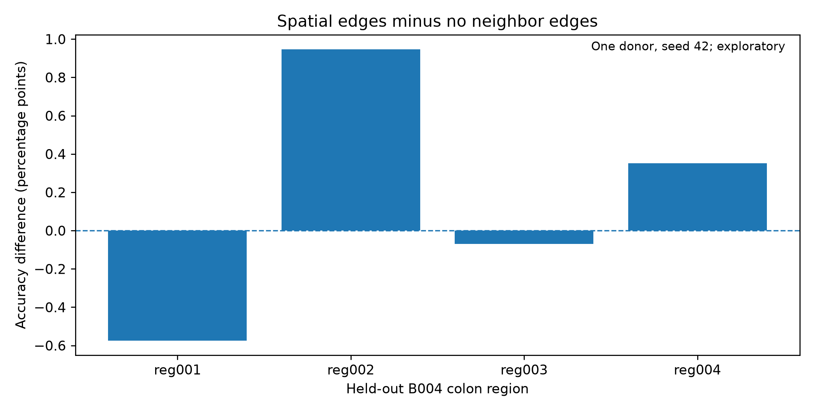

# Spatial neighborhoods in single-cell classification

**An independent reproduction and ablation study based on STELLAR**

This project started with a reproduction of [STELLAR](https://github.com/snap-stanford/stellar), a graph-based method for annotating spatial single-cell measurements. I then used its supervised Encoder to test a narrower question: **does including nearby cells improve cell-type prediction compared with using each cell's protein measurements alone?**

The main analysis uses public CODEX data from four colon regions. Adding spatial edges changed predictions, but it did not consistently improve classification. In particular, balanced accuracy was lower with spatial edges in all four held-out regions.

This is a study of STELLAR's **Encoder**, not a benchmark of the full STELLAR pipeline for discovering candidate novel cell types.

## Main experiment: held-out colon regions

The [B004 CODEX dataset](https://doi.org/10.5061/dryad.g4f4qrfrc) contains 110,633 annotated colon cells from four regions of one donor, measured with 48 protein markers. In each run, two regions were used for training, one for checkpoint selection, and one for testing. Each region was tested once.

Both models used the same supervised Encoder and training settings. The *spatial* model received a graph of neighboring cells; the *no-edges* control used the same architecture with neighbor edges removed. Protein normalization was fitted on training regions only.

| Test region | Cells | Accuracy difference (pp) | Macro-F1 difference | Balanced accuracy difference (pp) |
|---|---:|---:|---:|---:|
| reg001 | 33,793 | -0.5741 | -0.0583 | -3.8933 |
| reg002 | 21,232 | +0.9467 | -0.0072 | -1.3158 |
| reg003 | 30,545 | -0.0688 | +0.0050 | -0.1694 |
| reg004 | 25,063 | +0.3511 | +0.0031 | -1.5129 |
| **Mean of four regions** | | **+0.1637** | **-0.0144** | **-1.7228** |

Differences are **spatial minus no-edges**; positive values favor the spatial model. Macro-F1 uses a fixed set of 20 colon cell types. The mean gives each region equal weight.



[Macro-F1 figure](figures/b004_region_effects_macro_f1.png) · [Balanced accuracy figure](figures/b004_region_effects_balanced_accuracy.png) · [Full four-region analysis](docs/b004_four_region_summary.md)

Across the four test regions, the spatial model made **74 more correct predictions out of 110,633 cells** in total, equivalent to a pooled accuracy difference of approximately **0.067 percentage points**. That pooled estimate weights cells equally; the table's mean weights regions equally. Neither comparison supports a consistent advantage for adding neighbor edges.

Class-level changes also varied by region. For example, the spatial model's F1 for transit-amplifying (TA) cells improved in three regions but decreased substantially in the fourth.

## Earlier reproduction and same-graph experiment

I ran the published STELLAR training and prediction workflow on the authors' preprocessed Tonsil/Barrett's esophagus example: **86,984 labeled reference cells**, **45,958 unlabeled target cells**, and **44 markers**. This run produced predictions for the target graph, including candidate novel-class assignments. These are model outputs, not confirmed discoveries.

A separate experiment compared the supervised Encoder with and without spatial edges on the 86,984 labeled reference cells. It used a **transductive 70/10/20 label split** on the same graph and four random seeds (42, 7, 123, 2026).

| Test metric, mean ± SD across four seeds | Spatial | No edges |
|---|---:|---:|
| Accuracy | 0.9332 ± 0.0010 | 0.9344 ± 0.0029 |
| Macro-F1 | 0.8707 ± 0.0189 | 0.8755 ± 0.0117 |
| Balanced accuracy | 0.8539 ± 0.0291 | 0.8615 ± 0.0200 |

The two models performed similarly. An additional post hoc analysis suggested that local cell-type composition might affect the usefulness of neighbor aggregation, but that pattern has not been tested on independent samples.

[Full research report](Research_summary.md) · [Same-graph analysis scripts](scripts/reproduction/) · [Same-graph Macro-F1 figure](figures/macro_f1_from_local_results.png)

## Code and reproducibility

The main scripts are:

| File | Purpose |
|---|---|
| [run_b004_region_holdout.py](scripts/run_b004_region_holdout.py) | Train and evaluate one held-out colon region |
| [audit_b004_holdout.py](scripts/audit_b004_holdout.py) | Check class coverage and paired test predictions |
| [summarize_b004_regions.py](scripts/summarize_b004_regions.py) | Combine region-level performance and class F1 |
| [plot_b004_regions.py](scripts/plot_b004_regions.py) | Recreate the three region-level result figures |
| [scripts/reproduction/](scripts/reproduction/) | Tonsil/Barrett's esophagus reproduction and analyses |

The experiments used **Python 3.11, PyTorch 2.10.0+cu128, PyTorch Geometric 2.8.1, and an NVIDIA RTX 5090**. The original STELLAR code required minor compatibility updates for the more recent PyTorch Geometric and Scanpy environment.

Download the public [B004 CODEX CSV](https://doi.org/10.5061/dryad.g4f4qrfrc) separately and clone the [original STELLAR source](https://github.com/snap-stanford/stellar). The following runs the reg004 example from this repository's root:

```bash
python scripts/inspect_b004_csv.py /path/to/B004_training_dryad.csv

python scripts/run_b004_region_holdout.py \
  --csv /path/to/B004_training_dryad.csv \
  --stellar-src /path/to/stellar \
  --test-region reg004_CL_B004 \
  --val-region reg003_CL_B004 \
  --seed 42 --max-epochs 250

python scripts/audit_b004_holdout.py --results results/b004_region_holdout
python scripts/summarize_b004_regions.py --results results --out tables
python scripts/plot_b004_regions.py --csv tables/b004_region_effects.csv
```

The four-region analysis was run separately for each held-out region. Aggregate results and figures are included here. Raw CODEX files, per-cell predictions, and trained weights are not included.

**Important method detail:** the B004 spatial graphs use a symmetrized, distance-bounded k-nearest-neighbor construction (up to eight neighbors, radius 50), rather than the complete radius graph used in the original STELLAR implementation. Removing edges disables neighbor messages in GraphSAGE but retains its self-node transformation.

## Interpretation

These are exploratory results from **one donor**. The four held-out regions are not four independent patients, and the B004 experiments have so far used only one random seed. The same-graph experiment also allowed test-node features and spatial structure to be available during training, though test labels were masked. Neither experiment measures the performance of STELLAR's complete novel-cell-type discovery task.

The practical result is limited but useful: adding spatial neighbors did not reliably improve cell-type classification in these settings. Testing other donors, graph constructions, and random seeds would be needed before drawing broader conclusions.

## References

- Brbić M, Cao K, Hickey JW, et al. [Annotation of spatially resolved single-cell data with STELLAR](https://doi.org/10.1038/s41592-022-01651-8). *Nature Methods* 19, 1411–1418 (2022).
- [STELLAR source code](https://github.com/snap-stanford/stellar) (MIT license).
- [Preprocessed STELLAR example](https://zenodo.org/records/6836373).
- [Original CODEX dataset](https://doi.org/10.5061/dryad.g4f4qrfrc).

This repository is an independent analysis and is not an official STELLAR release.
