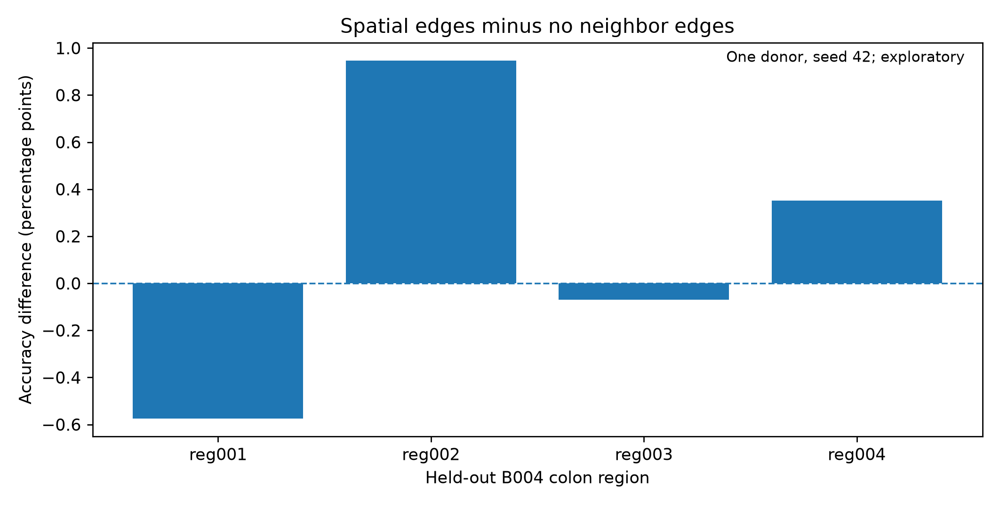

# Spatial Neighborhoods and Cell-Type Classification in CODEX Data

**Independent STELLAR reproduction and supervised Encoder ablation**  
**Zhixuan Zheng · November 2026**

## Abstract

I reproduced the STELLAR training and prediction workflow and examined whether spatial neighbor information improves cell-type classification in CODEX data. The comparison used STELLAR's supervised GraphSAGE Encoder with either its spatial edges retained or all neighbor edges removed. I first evaluated four random seeds on a transductive Tonsil/Barrett's esophagus reference graph, then conducted region-held-out experiments using 110,633 annotated colon cells from donor B004.

The same-graph comparison showed little difference between the models (mean Macro-F1: 0.8707 with spatial edges and 0.8755 without). The four B004 held-out regions also showed mixed results. Spatial edges improved accuracy in two regions and reduced it in two. Mean region-level accuracy differed by +0.164 percentage points, while mean Macro-F1 differed by −0.0144 and balanced accuracy by −1.723 percentage points (spatial minus no edges). The results suggest that spatial aggregation does not consistently improve classification in these settings. They do not address the full STELLAR novel-cell discovery task or generalization between donors.

## Background

Multiplexed imaging measures protein expression in individual cells while retaining their positions in tissue. Standard cell-type classifiers use a cell's own marker measurements, whereas graph neural networks can incorporate information from nearby cells.

STELLAR, introduced by Brbić and colleagues in *Nature Methods* (2022), uses an annotated spatial reference dataset to predict cell types in a target dataset and identify candidate novel populations. In its published implementation, the Encoder includes a GraphSAGE neighborhood-aggregation layer. This provided a direct way to test whether neighboring cells improve supervised cell-type predictions.

The question in this project is narrower than the original method's goal: **how much do spatial neighbor edges contribute to classification by this Encoder, compared with retaining only a cell's own marker measurements?**

## Data and experimental setup

### 1. Reproducing the STELLAR workflow

I used the authors' preprocessed Tonsil/Barrett's esophagus example, which contains 86,984 labeled reference cells, 45,958 unlabeled target cells, and 44 measured proteins. The training and prediction workflow ran on an NVIDIA RTX 5090 after compatibility adjustments for the current PyTorch Geometric and Scanpy environment.

The run returned assignments across 13 model output classes, including three candidate novel-class IDs. These are *model assignments*, not independently confirmed new cell types. The reported mean model confidence was approximately 0.9446; it is not a classification-accuracy estimate because ground-truth labels for those target cells were not used in this run.

### 2. Same-graph supervised ablation

I used the original STELLAR Encoder in an additional supervised classification experiment on the 86,984 labeled reference cells, with two conditions:

- **Spatial:** use the supplied cell-neighborhood graph.
- **No edges:** remove all neighbor edges while keeping the same Encoder architecture, self-node transformation, training schedule, and label split.

The split was stratified by cell type, with 70% of labels for training, 10% for validation, and 20% for testing. All cell features and the graph remained available; only labels were masked. Thus this is **transductive node classification**, not an independent-section test. The two conditions were run under seeds 42, 7, 123, and 2026, for at most 250 epochs. The best checkpoint was selected using validation Macro-F1.

I also examined the fraction of each cell's graph neighbors with the same *true* cell-type label. This homophily analysis was done after prediction, for interpretation, and did not alter model inputs or selection.

### 3. Region-held-out colon experiment

The second dataset was the public B004 CODEX CSV. I restricted the analysis to the 110,633 colon cells, comprising **four spatial regions, 48 protein markers, and 20 annotated cell types from one donor**. Small-intestine cells were not included.

In each fold, I used two regions for training, one for validation, and one for testing. Each of the four colon regions served as the test region once. A StandardScaler was fitted only on the training cells and applied unchanged to validation and test cells. The model received separate graphs for each partition; it could not exchange messages across regions.

For computational efficiency, I constructed **symmetrized, radius-bounded k-nearest-neighbor graphs (up to eight neighbors within radius 50)**. This differs from the original STELLAR full-radius neighbor graph, so the resulting experiment should be interpreted as a specific graph-construction variant rather than a direct re-evaluation of the published pipeline.

Both models used the STELLAR Encoder with the same optimizer settings and training-region data. Training ran for up to 250 epochs with checkpoint selection based on validation Macro-F1. Region experiments currently use only **seed 42**. The test labels were not used to fit the model or choose checkpoints within a fold. The subsequent analyses are exploratory because earlier test outcomes were visible while the study was being extended.

## Results

### Same-graph comparison

| Metric, four random seeds | Spatial, mean ± SD | No edges, mean ± SD |
|---|---:|---:|
| Accuracy | 0.9332 ± 0.0010 | 0.9344 ± 0.0029 |
| Macro-F1 | 0.8707 ± 0.0189 | 0.8755 ± 0.0117 |
| Balanced accuracy | 0.8539 ± 0.0291 | 0.8615 ± 0.0200 |

Neither configuration had a substantial overall advantage on this graph. The mean Macro-F1 difference (spatial minus no edges) was approximately −0.0047.

Spatially adjacent cells shared their type more often than expected under a simple independent-endpoint reference: 45.72% of recorded edges joined cells of the same type, compared with a 25.10% baseline. Differences between models varied with neighborhood composition:

| Same-type neighbor fraction | Mean accuracy difference, spatial − no edges (pp) | Positive seeds |
|---|---:|---:|
| 0–25% | −0.409 | 1/4 |
| 25–50% | −0.109 | 1/4 |
| 50–75% | +0.145 | 2/4 |
| 75–100% | +0.183 | 4/4 |

This trend prompted a post hoc hypothesis that neighborhood homogeneity may affect the usefulness of message passing. The effect was small and the same cells were reused across seeds. Cell identity, region composition, graph degree, and classification difficulty may confound the relationship. This analysis is descriptive rather than a biological finding.

### Four B004 colon regions

The primary cross-region results are shown below. All differences are *spatial minus no edges*. Accuracy and balanced-accuracy differences are in **percentage points**; Macro-F1 is reported in its original 0–1 scale. The Macro-F1 comparison uses the **same 20 colon classes** in every fold, including a zero-support class in reg004.

| Held-out region | Test cells | Accuracy difference (pp) | Macro-F1 difference | Balanced accuracy difference (pp) |
|---|---:|---:|---:|---:|
| reg001 | 33,793 | −0.5741 | −0.0583 | −3.8933 |
| reg002 | 21,232 | +0.9467 | −0.0072 | −1.3158 |
| reg003 | 30,545 | −0.0688 | +0.0050 | −0.1694 |
| reg004 | 25,063 | +0.3511 | +0.0031 | −1.5129 |
| **Mean across regions** | | **+0.1637** | **−0.0144** | **−1.7228** |

[Macro-F1 differences](figures/b004_region_effects_macro_f1.png) · [Balanced accuracy differences](figures/b004_region_effects_balanced_accuracy.png)

The model with spatial edges had higher accuracy in two of four regions, and higher fixed-class Macro-F1 in two of four. Balanced accuracy was lower in all four regions. Summing the paired predictions across the four distinct held-out test regions, spatial aggregation resulted in **74 additional correct labels among 110,633 cells**. This is a pooled difference of about **+0.067 percentage points**; it differs from the unweighted mean of four regional percentage differences because the regions have different cell counts.

The reg004 fold illustrates why class definitions matter. It has **19 observed test classes**, although the colon dataset contains 20 classes. For this fold, Macro-F1 was 0.7984 (spatial) versus 0.7951 (no edges) when averaging only the 19 present classes, but 0.7584 versus 0.7554 when averaging over the fixed 20-class vocabulary. Neither method had missing test classes that were absent from training.

### Cell-type-specific differences

Cell-type F1 changes varied across test regions. Transit-amplifying (TA) cells gained F1 from spatial edges in reg002 (+0.0729), reg003 (+0.0145), and reg004 (+0.0222), but lost F1 in reg001 (−0.1052). Macrophage F1 was slightly lower with spatial edges in all four regions (−0.0011 to −0.0094). Lymphatic cells were also inconsistent.

Some classes had very few test cells. For example, in reg004 there were only four CD7_Immune cells and five Enterocyte_CD57p cells; comparatively large F1 changes in these classes are not reliable evidence of distinct biological behavior.

The differences could reflect regional variation in marker intensity, cell-type composition, local tissue structure, or sensitivity of GraphSAGE aggregation to graph construction. The current analyses cannot separate these explanations.

## Interpretation

The practical conclusion is that **adding spatial neighbor edges did not reliably improve supervised cell-type classification** for the tested STELLAR Encoder setup. Overall accuracy was broadly similar, with mixed regional effects. The lower balanced accuracy in all four B004 folds suggests that improvements among abundant cell types did not translate into consistent gains across the full label distribution.

This does **not** show that spatial information is unhelpful in general. The result is specific to these datasets, training choices, graph construction, and single-layer GraphSAGE Encoder. Different spatial graphs, tasks, architectures, or tissue sources may behave differently.

## Limitations

The B004 colon regions all come from **one donor**; region-held-out testing is not independent-patient validation. The four folds also share partially overlapping training data. The region experiment was performed with one seed and one graph-construction setting. Test performance was examined during exploratory development, so the folds should not be presented as a pre-registered, untouched external benchmark.

The earlier Tonsil/Barrett's esophagus experiment used **transductive cell-level splitting**, which does not establish independent-section generalization. The neighborhood-homophily analysis relied on known labels after prediction and is observational.

Finally, these ablations evaluate **only the supervised STELLAR Encoder**. Full STELLAR also models unlabeled targets and candidate novel cell types; those components are not evaluated by the no-edges comparison.

## Reproducibility and next checks

Public summary statistics, figure-generation code, and the experimental scripts are available in this repository. The raw CODEX files, per-cell prediction arrays, and model weights are not included. To reproduce the B004 experiments, obtain the public dataset and clone the upstream STELLAR implementation; see the [README](README.md) for commands and environment details.

Future work should check whether the result persists across random seeds, full-radius versus kNN graphs, and **separately annotated donors**. The graph configuration should be selected using training/validation data rather than optimizing against the test folds.

## References

Brbić M, Cao K, Hickey JW, et al. *Annotation of spatially resolved single-cell data with STELLAR*. *Nature Methods* 19, 1411–1418 (2022). https://doi.org/10.1038/s41592-022-01651-8

[Original STELLAR implementation](https://github.com/snap-stanford/stellar) · [Public CODEX data](https://doi.org/10.5061/dryad.g4f4qrfrc) · [Preprocessed example](https://zenodo.org/records/6836373)
